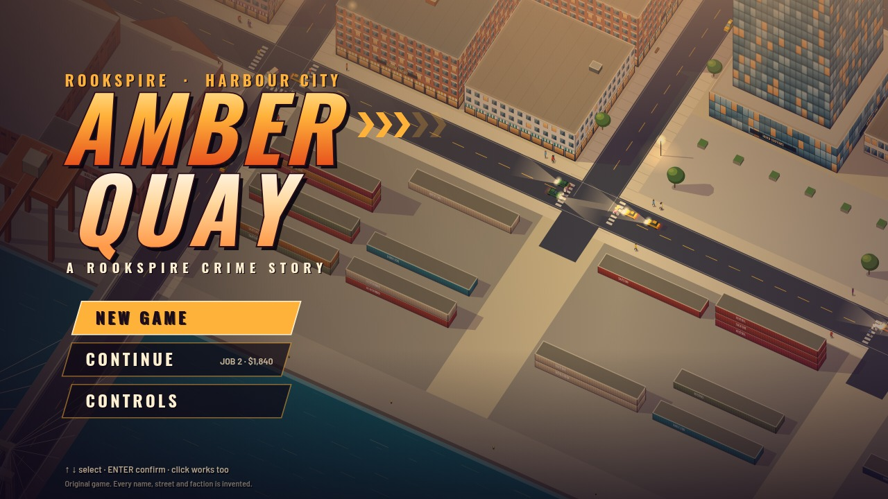

# AMBER QUAY

[](https://make.fun/bounty/gta6-01?utm_source=github&utm_medium=readme&utm_campaign=gta6-01)
[](https://make.fun/bounty/gta6-01/leaderboard?utm_source=github&utm_medium=readme&utm_campaign=gta6-01)
[](https://make.fun/bounty/gta6-01?utm_source=github&utm_medium=readme&utm_campaign=gta6-01)

An original open-world crime game for the make.fun **gta6-01** bounty. You are **Nim Calder**, a dock runner
taking jobs in **Rookspire**, a fictional river-port, after the Harbour Authority collapsed. Every name, street,
faction and vehicle is invented. It is a single offline page: static files, a custom 2.5D canvas renderer,
Web Audio oscillators for all sound, no network requests and no engine.



## Run it

```
node serve.ts
```

then open <http://localhost:8080> in desktop Chrome. (`node serve.ts --port 9000` picks another port.)
`game/index.html` also works from any static file server; nothing is fetched from the network.

To build the hand-in folder the way the grader does:

```
mkdir -p out && MAKEFUN_OUTPUT_DIR=out node main.ts
```

## Controls

| Input | Action |
| --- | --- |
| W A S D / arrows | Walk, or throttle and steer in a car |
| Shift | Sprint |
| Mouse | Aim |
| Left click | Fire the Rivet .38 (or punch with fists equipped) |
| Right click / V | Punch |
| R | Reload |
| 1 / 2 / Tab | Fists, pistol, swap |
| F | Enter / exit a vehicle, carjack a driver |
| Space | Handbrake |
| H | Horn |
| Q / E | Rotate the camera |
| M | Music on or off |
| Esc / P | Pause |

## What is in it

* **Rookspire**: a 1.3 km square river-port with a park, market, downtown towers, a glass customs tower, hillside
  terraces, docks with rust-orange gantry cranes and container yards, a tram line, a cable bridge, and a south bank.
* **Traffic and people**: lane-following cars with working signals, parked cars you can steal, tram traffic,
  pedestrians who use sidewalks and crosswalks and flee from trouble.
* **Driving**: handbrake drifts, skid marks, crash damage, smoke, fire and explosions, brake and head lights.
* **Heat and police**: an amber five-chevron heat meter. Crimes raise heat, cruisers with light bars and
  oscillator sirens chase along the road graph, ram, then deploy officers who shoot or arrest you. Lose them to cool off.
* **Combat**: punch combos, a pistol with reloads, bullets, muzzle flash, hit feedback, health, wasted and busted.
* **Story**: three jobs from Odile Varga (first run, the Marlin GT delivery, the Customs Tower confrontation),
  then free roam. Continue picks the story up from localStorage.
* **Presentation**: late-afternoon light with long cast shadows, facade textures with windows, awnings and signs
  generated at runtime, a rotated minimap, subtitles and banners.

## Photo modes

`?shot=title|downtown|chase|mission&seed=1` poses the camera, traffic, heat and HUD deterministically, then sets
`document.documentElement.dataset.shotReady = "1"`. The screenshots in `screenshots/` are real Chrome captures
of those URLs (see `shots.json`).

## Layout

```
game/index.html          entry page
game/src/world.js        city layout, buildings, props, road and walk graphs
game/src/gfx.js          camera, lighting, procedural facade textures
game/src/render.js       ground, shadows, depth-sorted solids, lights, minimap
game/src/game.js         simulation: vehicles, combat, heat, camera, saves
game/src/ai.js           traffic, police, pedestrians, enemies, population
game/src/missions.js     the three jobs
game/src/ui.js           HUD, title and menus
game/src/audio.js        synthesised sound and music
game/src/main.js         input, loop, photo modes
main.ts                  copies game/ and screenshots/ and builds the dossier
serve.ts                 tiny static server
```

## Licence

MIT. See `LICENSE`.
